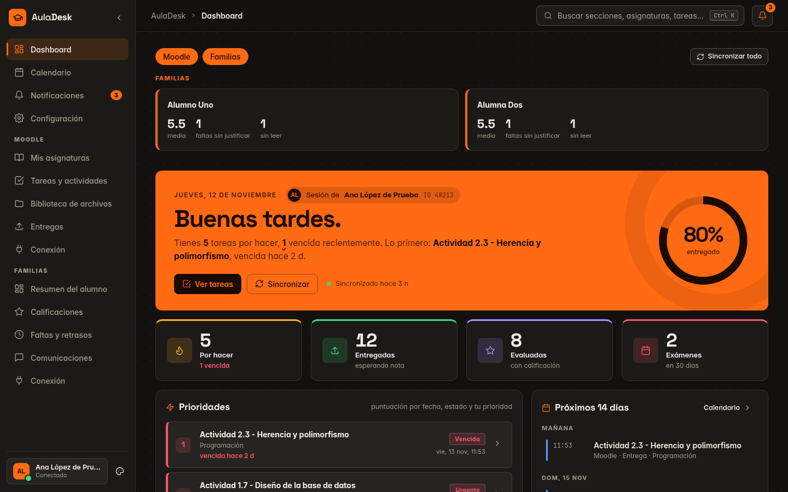
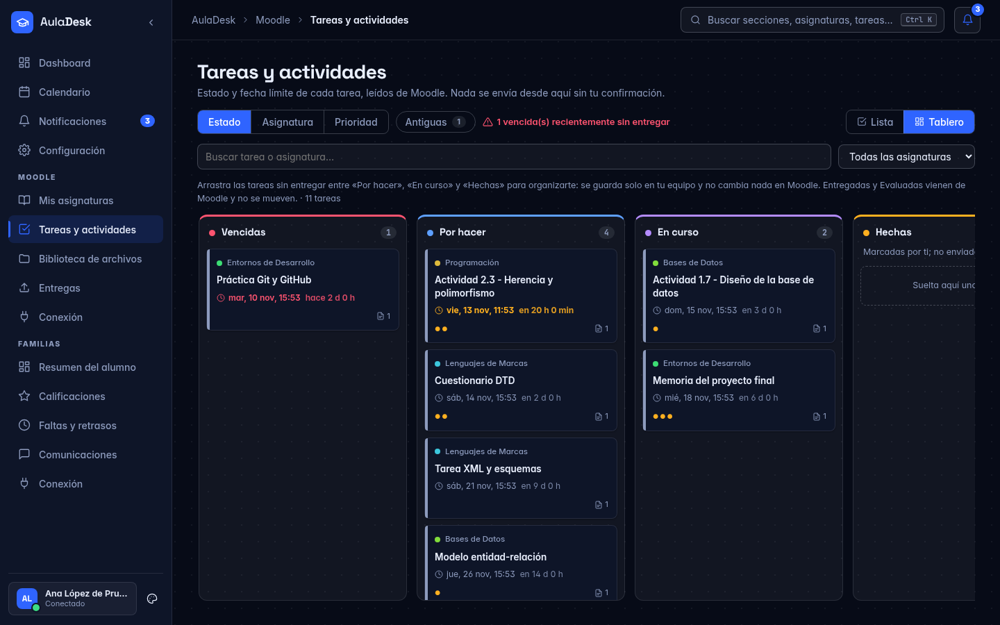
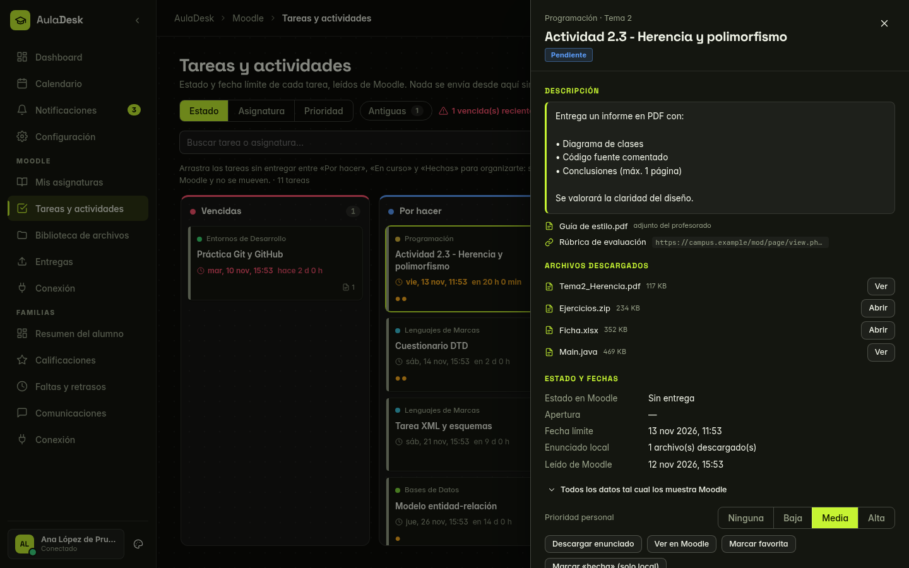
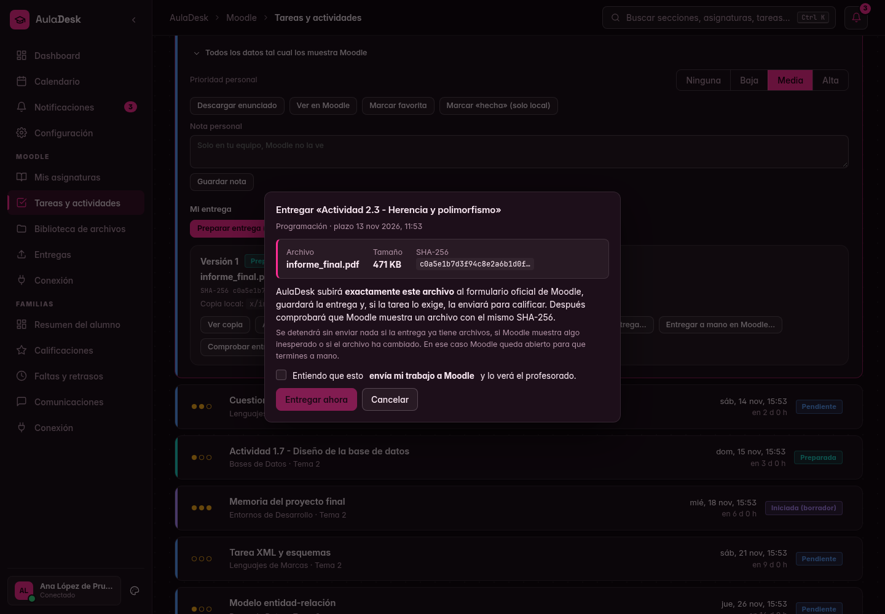
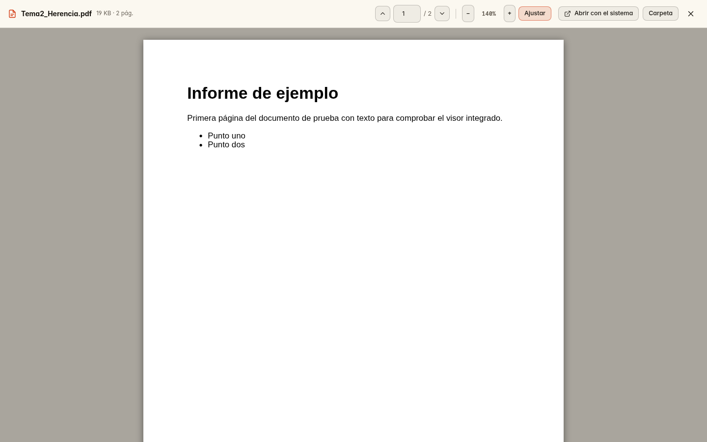
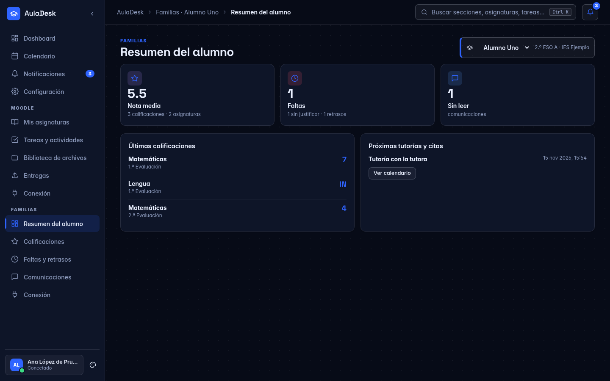
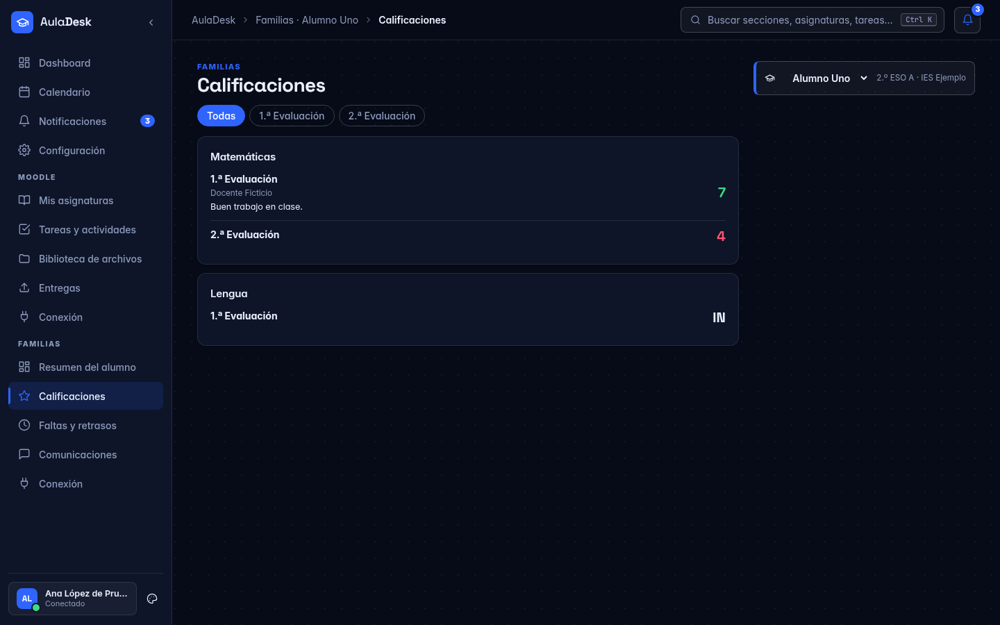
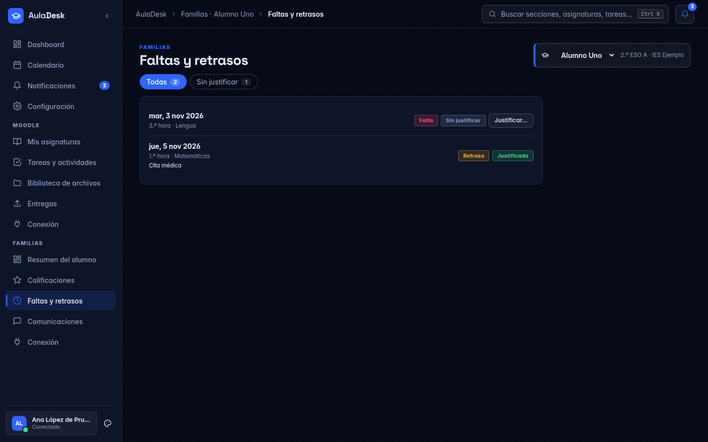
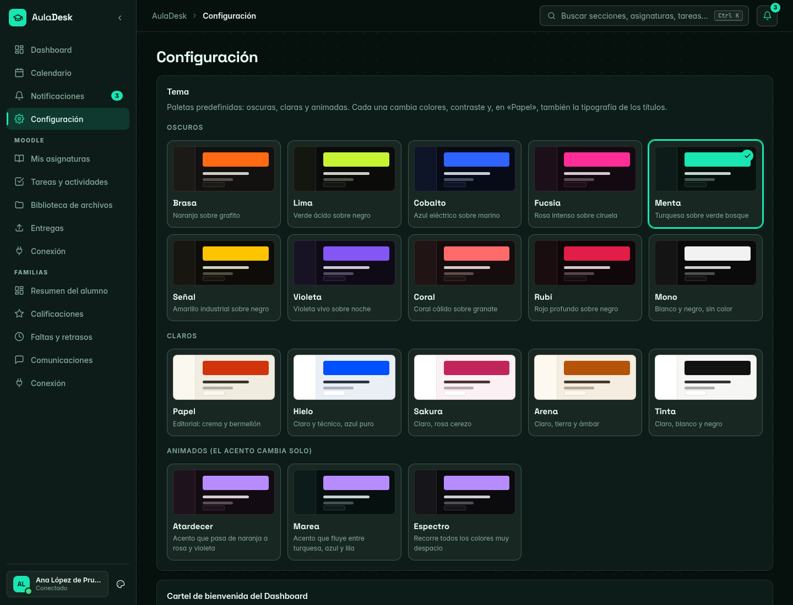

# AulaDesk

Cliente de escritorio y **personal** para plataformas [Moodle](https://moodle.org) y para el portal de familias del centro: reúne tareas, fechas límite, archivos, calificaciones, faltas y avisos en una aplicación local rápida, y te ayuda a **preparar y comprobar entregas sin enviar nada por ti**. Lo único que puede enviar es tu entrega, con confirmación explícita.

> AulaDesk es un proyecto independiente. **No está afiliado, patrocinado ni respaldado por Moodle Pty Ltd, Moodle HQ ni la Junta de Andalucía.** «Moodle» es una marca de sus titulares.



*Capturas de la versión 0.3.1 con datos de ejemplo (nombres, alumnado, centro y tareas ficticios).*

## Qué hace

- **Dashboard**: saludo con resumen real, progreso, prioridades con puntuación transparente, próximos 14 días y actividad reciente.
- **Asignaturas y biblioteca**: sincroniza cursos, temas y actividades; descarga archivos con verificación SHA-256, sin duplicados y con versiones.
- **Tareas**: estado y fecha límite de cada tarea en **lista o tablero** (por estado, asignatura o prioridad, con arrastre en este último).
- **Entregas**: copias versionadas e inmutables de lo que preparas. Puedes **entregar desde la app** (beta) o a mano en Moodle. Una entrega solo figura como *confirmada* si Moodle muestra un archivo con el **mismo SHA-256**. Entregar desde la app exige un diálogo de confirmación explícito (tarea, archivo, tamaño y hash), nunca es automático ni en lote, y se **detiene sin enviar** ante cualquier duda (p. ej. si la entrega ya tiene archivos).
- **Información completa de la tarea**: descripción, enlaces y adjuntos del profesorado, calificación y comentarios, y todos los datos tal cual los muestra Moodle.
- **Visor integrado**: PDF (pdf.js), imágenes, texto/código y CSV, sin salir de la app.
- **Sincronización automática** cada 10 min–12 h con avisos de tareas nuevas, cambios de fecha y notas; con bandeja del sistema para seguir en segundo plano.
- **Cartel de bienvenida** del Dashboard totalmente personalizable y animación de bienvenida al iniciar sesión.
- **Calendario y avisos**: eventos derivados de las fechas reales, recordatorios configurables (también con la app cerrada mediante un servicio de usuario opcional).
- **Familias (PASEN/iPasen)**: alumnado, calificaciones, faltas y retrasos y comunicaciones del portal, por alumno y con tu propia sesión (sin guardar contraseña); la sesión se conserva y se mantiene viva mientras la app está abierta. Las acciones de escritura (justificar una falta, pedir tutoría, mensaje) exigen confirmación explícita y quedan «no disponibles» mientras no haya una receta verificada contra el portal.
- **Base de datos cifrada** con SQLCipher (clave en el llavero del sistema) y **copia opcional en una carpeta sincronizada** (Google Drive para escritorio, OneDrive, Dropbox…).
- **Sincronización rápida y opcional al iniciar**: Moodle lee sin renderizar y solo relee lo que puede haber cambiado; Moodle y Familias se sincronizan a la vez.
- **Apariencia y accesibilidad**: 18 temas (algunos animados), efectos con ecualizador real (Linux), pantallas de bienvenida, español/inglés, alto contraste, densidad y tamaño; paleta de comandos `Ctrl+K`.

### Tareas: lista o tablero, con todo el detalle



### Entregar desde la app (beta) y visor integrado



### Familias




### Temas y personalización


## Principios de seguridad y privacidad

- **Nunca guarda tu contraseña.** Inicias sesión tú en la ventana de Moodle (incluido el SSO de tu centro).
- La sesión se conserva como cookies de los dominios de la plataforma en el **llavero del sistema** (Secret Service); caduca según el servidor. «Cerrar sesión y olvidarla» hace logout y borra todo.
- Todo se guarda **en local** (SQLite + carpeta de archivos). Sin telemetría ni servicios de terceros.
- Solo lee las páginas que ya ves con tu sesión y no usa tokens ajenos. El único envío posible es el de **tu** entrega, tras tu confirmación explícita y verificado por SHA-256. Detalle en [`docs/SECURITY.md`](docs/SECURITY.md).
- Usa la web de Moodle como cualquier navegador; comprueba que las normas de uso de tu centro permiten herramientas de este tipo antes de usarla.

## Estado y límites

Proyecto personal en desarrollo (`v0.3.1`), **desarrollado y probado contra instancias concretas** (Moodle 5.x de la Junta de Andalucía, tema «moove», y su portal de familias): las URL base y los selectores están fijados en ese entorno (`src-tauri/src/moodle/`, `src-tauri/src/familias/`, `src-tauri/selectors/`). Adaptarlo a otra instalación exige tocar esas constantes y revalidar los selectores. En Familias, la tabla de notas solo se ha visto vacía (sin datos reales) y el portal solo muestra el perfil activo de la cuenta. Lo verificado y lo **no** verificado está listado con honestidad en [`PROGRESS.md`](PROGRESS.md).

Probado en Linux (Arch, Hyprland/Wayland). **Windows y macOS: la configuración de compilación está preparada pero no se ha probado**; allí las notificaciones de escritorio y el servicio en segundo plano (que usan `notify-send` y `systemd`) no están disponibles todavía.

**Entregar desde la app es beta:** el flujo se ha probado contra una página que imita el formulario de Moodle, **no contra un Moodle real**. Pruébalo primero con una tarea sin importancia.

## Instaladores y Docker

Los instaladores de cada versión (Linux, Windows y macOS) están en [Releases](https://github.com/AdriLabTech/auladesk/releases).

AulaDesk es una app de escritorio (ventana + llavero del sistema + sesión SSO en un WebView), así que **Docker se usa para compilar, no para ejecutarla**:

```bash
./scripts/build-docker.sh                         # genera ./instaladores/deb y ./instaladores/rpm en Linux (Debian 12)
BUNDLES=deb,rpm,appimage ./scripts/build-docker.sh # además AppImage (descarga linuxdeploy; necesita red)
docker build --target check .                     # tipos de Svelte + pruebas de Rust, aislados
```

Para **Windows (msi/exe), macOS (dmg) y Linux** a la vez, el flujo [`release.yml`](.github/workflows/release.yml) construye los instaladores en GitHub Actions al publicar una etiqueta `vX.Y.Z` y deja un borrador de release. Los instaladores **no están firmados**: Windows (SmartScreen) y macOS (Gatekeeper) mostrarán un aviso hasta que se añada un certificado de firma.

Dependencias de ejecución en Linux: WebKitGTK 4.1, GTK 3, `libayatana-appindicator3` (bandeja) y un servicio de llavero (gnome-keyring o similar).

## Compilar y ejecutar

Requisitos: Rust estable, Node.js 20+, dependencias de Tauri 2 para Linux (WebKitGTK 4.1, libsecret) y un servicio de llavero (gnome-keyring o similar).

```bash
npm install
npm run check                      # tipos de Svelte
npm test                           # 29 pruebas de interfaz (temas, i18n, loader)
(cd src-tauri && cargo test --lib) # 126 pruebas
npx tauri build --debug --no-bundle
./src-tauri/target/debug/auladesk
```

Variables de desarrollo: `AULADESK_DATA_DIR` (carpeta de datos alternativa, útil para probar sin tocar tus datos) y `AULADESK_DEV_CTL=1` (canal de control local solo para desarrollo, apagado por defecto).

> Nota: por compatibilidad con instalaciones previas, la carpeta de datos (`~/.local/share/moodledesk`), el identificador de Tauri y la entrada del llavero conservan el nombre histórico del proyecto.

## Arquitectura

Tauri 2 (Rust) + Svelte 5 + SQLite cifrada (SQLCipher). Resumen en [`docs/ARCHITECTURE.md`](docs/ARCHITECTURE.md); base de datos en [`docs/DATABASE.md`](docs/DATABASE.md); integración con Moodle en [`docs/MOODLE_INTEGRATION.md`](docs/MOODLE_INTEGRATION.md).

## Licencia

[MIT](LICENSE). Las tipografías (Inter, Space Grotesk, Fraunces, JetBrains Mono) **no se incluyen**: se usan si están instaladas en el sistema.
